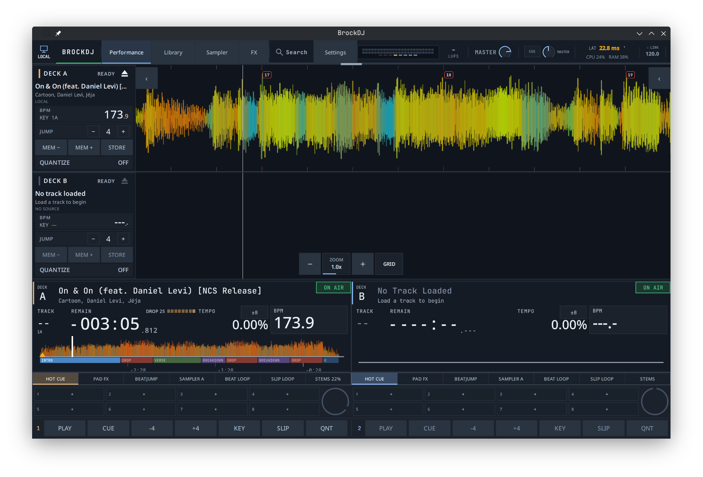

# BrockDJ

**Open-source DJ software for Linux and macOS, built with C++23, JUCE and Qt 6.**

Four decks, CDJ-style performance tools, stem separation, a sampler with a step
sequencer and Pioneer DDJ-FLX10 support.

[Features](docs/features.md) · [Installation](docs/installation.md) · [Documentation](docs/README.md)

## Highlights

- **Four-deck mixing** with EQ, filters, effects, key lock and sync.
- **Performance tools:** hot cues, loops, slip mode, quantize and vinyl-style scratching.
- **Waveforms and analysis:** GPU-rendered waveforms, BPM, key, beat grids and song parts.
- **Local stems:** separate vocals, melody, bass and drums, with cached preanalysis.
- **Sampler and sequencer:** four sample banks and patterns of up to 64 steps.
- **Library and live use:** playlists, advanced search, Rekordbox USB browsing,
  automix, set recording and Pioneer DDJ-FLX10 integration.

Explore the [full feature overview](docs/features.md).

## Get started

Build BrockDJ from source on Linux or macOS with the
[installation guide](docs/installation.md). It covers dependencies, building,
updating and running tests. To enable stem separation, follow the
[stems setup guide](docs/stems.md).

For advanced builds, controller setup and CI presets, see the
[detailed build guide](docs/building.md). All guides and technical notes are
listed in the [documentation index](docs/README.md).

## Project status

BrockDJ is under active development, primarily by a single developer with
assistance from AI tools. The focus is on functionality, performance and
stability; expect bugs, unfinished features and larger changes.

Linux is the primary development platform, macOS is actively supported, and
Windows is not actively maintained. **BrockDJ is a working name** — name ideas
are welcome in an issue or discussion.

## License

BrockDJ is licensed under the [GNU Affero General Public License v3.0 or later](LICENSE).
Third-party components and the stem model are listed in [NOTICE](NOTICE).
